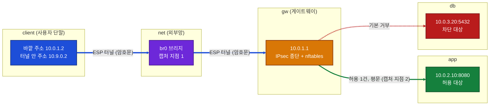
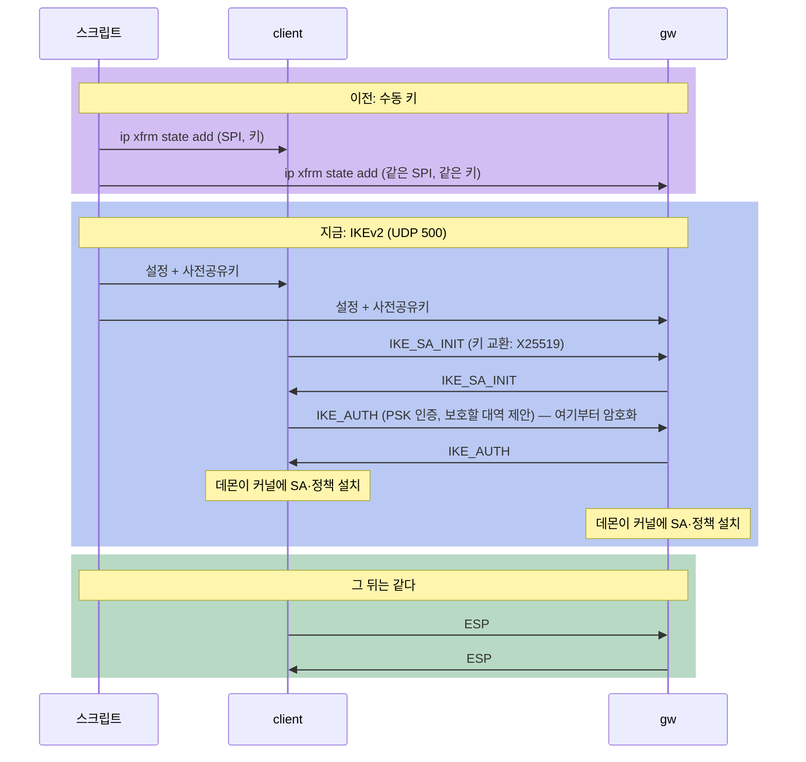
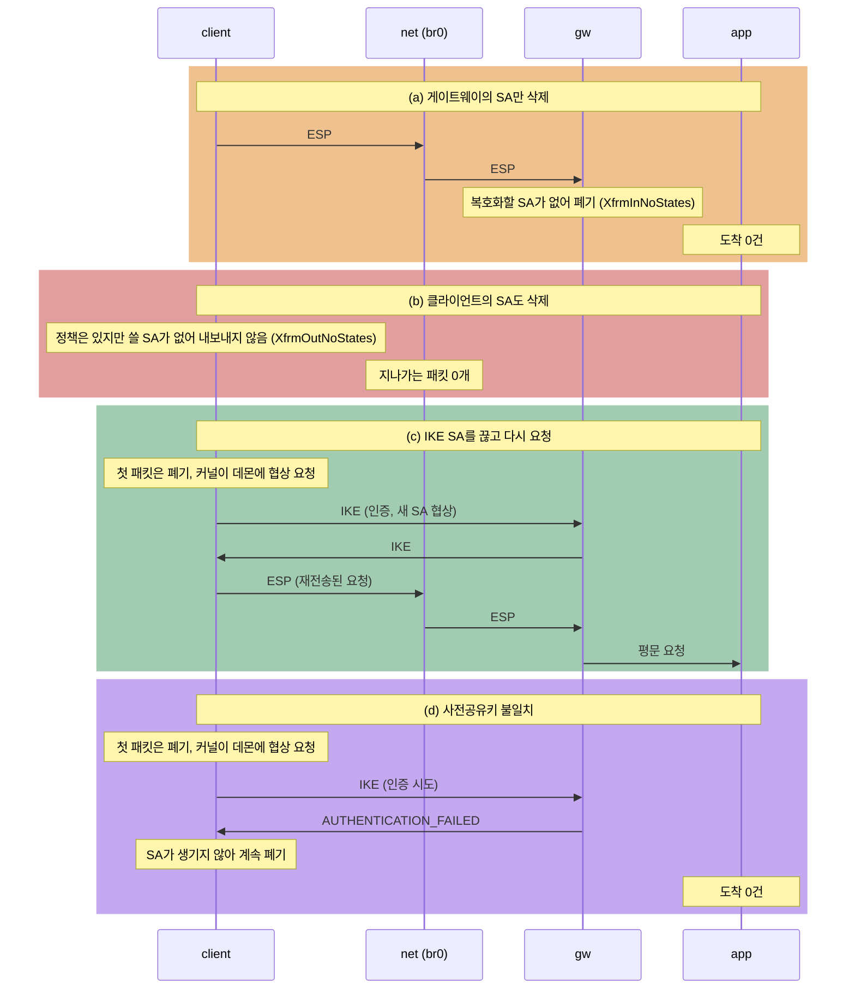
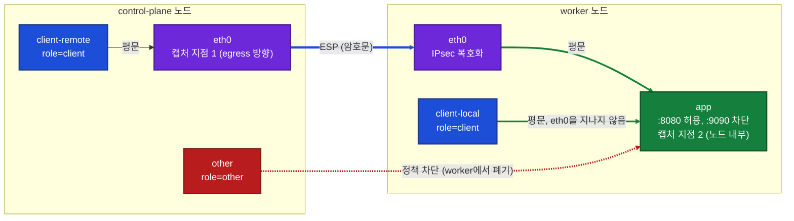

# ipsec-gateway-lab

[](https://github.com/loquemedalagana/ipsec-gateway-lab/actions/workflows/lab.yml) [](https://github.com/loquemedalagana/ipsec-gateway-lab/actions/workflows/cilium.yml)

리눅스 네트워크 네임스페이스만으로 만든 작은 VPN 게이트웨이 실습입니다.
클라이언트와 게이트웨이 사이를 IPsec(ESP 터널 모드)으로 암호화하고, 게이트웨이에서 기본 거부 + 명시 허용으로 접근을 제어한 뒤, 패킷 캡처와 연결 매트릭스로 확인합니다.

암호화와 접근제어는 리눅스 커널 기능(`ip netns`, xfrm, `nftables`)이 하고, 키 교환(IKE)만 strongSwan에 맡겼습니다. 전체를 셸 스크립트로 조립했습니다.

같은 질문을 쿠버네티스의 노드 간 투명 암호화(Cilium IPsec)에 던진 비교 단계가 따로 있습니다 → [비교: 쿠버네티스 노드 간 투명 암호화](#비교-쿠버네티스-노드-간-투명-암호화-cilium-ipsec)

## 확인하려는 것

1. 터널을 지나는 요청은 외부망에서 ESP로만 보이고, 터널 안 주소·포트·내용은 보이지 않는가
2. 암호화와 접근제어는 별개인가 — 터널로 들어왔더라도 허용 목록에 없는 목적지는 차단되는가
3. IPsec이 적용되지 않은 요청은 차단되는가
4. 차단은 이유와 함께, 무엇이 차단됐는지까지 기록되는가
5. SA가 없어졌을 때 요청이 평문으로 유출되지 않는가
6. 키를 사람이 넣지 않고 IKE로 협상해도 위 결과가 그대로인가 — 키를 바꿔도 통신이 이어지고, 인증에 실패하면 요청이 평문으로 나가지 않는가

## 구성



| 네임스페이스 | 역할 |
|---|---|
| `client` | 사용자 단말. 터널 안 주소 `10.9.0.2`로 내부망에 접근. IKE 데몬 1개 |
| `net` | 클라이언트와 게이트웨이 사이의 외부망(브리지). 제3자가 보는 패킷을 여기서 캡처 |
| `gw` | 게이트웨이. IPsec 종단 + nftables 접근제어. IKE 데몬 1개 |
| `app`, `db` | 내부 서버. 둘 다 실제로 포트를 열고 있음 |

- IPsec: ESP 터널 모드, AES-GCM, 방향별 SA 2개 → [lab/setup.sh](lab/setup.sh)
- 키 관리: SA와 키는 양쪽의 IKE 데몬(strongSwan, IKEv2)이 사전공유키(PSK)로 서로 인증한 뒤 협상해서 커널에 넣습니다. 사전공유키는 실행할 때마다 새로 만들고 출력하지 않습니다 → [lab/swanctl/](lab/swanctl/), [키 관리: 수동 키에서 IKE로](#키-관리-수동-키에서-ike로)
- 접근제어: forward 체인 기본 거부, 허용 1건(`터널 사용자 → app:8080`), 차단은 이유별 카운터 + 패킷별 로그 → [lab/policy.nft](lab/policy.nft)

## 이론과 명령의 대응

정보보안기사를 준비하며 이론으로 배운 IPsec·접근통제 개념이 리눅스에서 어떤 명령과 패킷으로 나타나는지 확인하려고 만들었습니다.

| 이론 | 이 실습에서 | 확인하는 곳 |
|---|---|---|
| ESP: 기밀성과 무결성을 제공하는 IPsec 프로토콜 | `proto esp` | 외부망 캡처의 `ESP(spi=…)` |
| 터널 모드: 원래 IP 패킷 전체를 암호화하고 새 IP 헤더를 붙임 | `mode tunnel` | 외부망에는 바깥 주소 `10.0.1.2 > 10.0.1.1`만, 안쪽 주소 `10.9.0.2`는 안 보임 |
| SA(보안 연관): 단방향이고 SPI로 식별 | `ip xfrm state` 2개 (SPI는 IKE가 정하므로 실행마다 다름) | 방향마다 다른 SPI가 캡처에 기록됨 |
| 보안 정책(SPD): 어떤 트래픽에 IPsec을 적용할지 | `ip xfrm policy` | 터널 안 주소로 보낸 요청만 ESP로 나감 |
| 재전송 방지: 순서 번호와 윈도우 | `replay-window 32` | 캡처의 `seq=0x1, 0x2, …` |
| 인증 암호화(AEAD) | `aead rfc4106(gcm(aes))` | SA 출력 |
| ARP: IP 주소로 MAC 주소를 알아냄 | 설정 없음 (커널이 첫 패킷 전에 자동 수행) | 두 캡처 맨 앞의 `ARP, Request who-has …`. IPsec은 IP 계층부터 보호하므로 ARP는 터널 밖에서 평문으로 보임 |
| 키 교환(IKE): 서로 인증한 뒤 키와 SA를 협상 | strongSwan `swanctl.conf` (IKEv2, `auth = psk`, X25519) | `out/ike_sas.txt`의 `ESTABLISHED`, 외부망 캡처의 `isakmp`(UDP 500) |
| 키 교체(rekey)와 PFS: 키를 바꿀 때 키 교환을 새로 함 | `swanctl --rekey`, `esp_proposals = aes128gcm16-x25519` | 교체 전후의 SPI가 다르고 요청은 계속 됨 |
| 기본 거부 + 명시 허용 | nftables `policy drop` + 허용 1줄 | 연결 매트릭스, 카운터 |
| 책임추적성: 무엇이 차단됐는지 기록 | nftables `log … group N` (nflog) | `out/drop_*.txt`의 출발지·목적지·포트 |

## 실행

GitHub Actions가 푸시마다 전체를 실행합니다. 실행 화면의 **Summary**에 IKE 협상 결과, 연결 매트릭스, 카운터, 차단 로그, 패킷 캡처, 키 교체, 장애 실험이 표시되고, 원본은 `evidence` 아티팩트로 남습니다.

로컬(리눅스, root):

```bash
sudo ./run.sh
```

`iproute2`, `nftables`, `tcpdump`, `curl`, `python3`, `strongswan-charon`, `strongswan-swanctl`이 필요합니다. 실행하는 동안 `/etc/netns/client`, `/etc/netns/gw`, `/tmp/ipsec-gateway-lab`을 만들고, 끝나면 지웁니다.

macOS에서는 Docker로 실행합니다.

```bash
docker run --rm --privileged -v "$PWD":/lab ubuntu:24.04 bash -c 'apt-get update -qq && apt-get install -y -qq iproute2 nftables tcpdump curl python3 strongswan-charon strongswan-swanctl && /lab/run.sh'
```

## 검사 항목

[run.sh](run.sh)는 아래가 하나라도 어긋나면 실패로 끝납니다.

| 검사 | 기대 |
|---|---|
| IKE 협상 | 양쪽 데몬이 모두 `ESTABLISHED`, 커널의 SA는 방향별 1개씩이고 양쪽의 SPI가 같음 |
| 외부망 캡처 | ESP 패킷이 있고, 터널 안 주소(`10.9.0.2`)와 포트(`8080`)는 0건 |
| 터널 안쪽 캡처 | 복호화된 HTTP 요청이 보임 |
| 터널 → app:8080 | ALLOW |
| 터널 → app:22 | DROP (허용 외 포트) |
| 터널 → db:5432 | DROP (허용 외 서버, 포트는 열려 있음) |
| 터널 없이 → app:8080 | DROP |
| 카운터 | `allow_app`, `deny_no_tunnel`, `deny_not_allowed` 모두 0보다 큼 |
| 차단 로그 | 차단한 3건이 이유에 맞는 파일에 있고, 허용한 요청은 0줄, 줄 수는 카운터와 같음 |
| 키 교체 | 교체 뒤 요청 ALLOW, 새 SPI가 방향별 1개씩 생김, 외부망에 IKE 메시지가 있고 평문 0건 |
| 장애 실험 (a)(b): 커널의 SA 삭제 | 요청 실패, 외부망 평문 0건, app 도착 0건 |
| 장애 실험 (c): 다시 협상 | 요청 ALLOW, 외부망에 IKE 메시지가 있고 평문 0건 |
| 장애 실험 (d): 사전공유키 불일치 | 요청 실패, 인증 실패 기록이 있고 IKE SA 0개, 외부망 ESP·평문 0건, app 도착 0건 |

결과는 세 가지로 나눕니다. `ALLOW`는 응답을 받은 것, `DROP`은 시간 초과(패킷이 응답 없이 폐기됨), `REFUSED`는 연결 거부(서버까지 갔는데 포트가 닫혀 있음)입니다. 정책이 차단했다면 `DROP`이어야 하고, `REFUSED`가 나오면 정책이 아니라 닫힌 포트 때문에 실패한 것이므로 검사가 실패합니다.

허용해야 할 쌍만 보면 "전부 열려 있는" 상태도 통과하고, 차단해야 할 쌍만 보면 "전부 차단된" 상태도 통과합니다. 그래서 둘 다 검사합니다.

## 차단 로그: 무엇이 차단됐는가

카운터는 "몇 번 차단했는가"만 알려 줍니다. 누가 어디로 가려다 차단됐는지를 남기려고, 차단 규칙에 `log`를 붙여 패킷마다 한 줄씩 기록합니다. nftables가 이유별 nflog 그룹(1 = `deny_no_tunnel`, 2 = `deny_not_allowed`)으로 보내고, `run.sh`가 게이트웨이에서 `tcpdump -i nflog:<그룹>`으로 받아 `out/drop_no_tunnel.txt`, `out/drop_not_allowed.txt`에 남깁니다.

```
# drop_not_allowed.txt — 터널로 들어왔지만 허용 목록에 없는 목적지
10.9.0.2.46754 > 10.0.2.10.22: Flags [S]
10.9.0.2.50696 > 10.0.3.20.5432: Flags [S]
# drop_no_tunnel.txt — IPsec이 적용되지 않은 패킷
10.0.1.2.55318 > 10.0.2.10.8080: Flags [S]
```

(시각과 TCP 옵션은 줄였습니다. 포트 번호는 실행마다 다릅니다.)

| 이유 | 카운터 | 로그 줄 수 | 로그에 남은 것 |
|---|---|---|---|
| `deny_no_tunnel` | 2 | 2 | `10.0.1.2 → 10.0.2.10:8080` |
| `deny_not_allowed` | 4 | 4 | `10.9.0.2 → 10.0.2.10:22`, `10.9.0.2 → 10.0.3.20:5432` |
| 허용한 요청 (`10.9.0.2 → 10.0.2.10:8080`) | — | 0 | 없음 |

(로컬 Docker와 GitHub Actions에서 같은 값. 요청 하나가 2초 안에 SYN을 한 번 재전송해서, 차단 1건이 로그 2줄로 남습니다.)

- 로그는 연결 단위가 아니라 패킷 단위입니다. 같은 연결 시도의 재전송도 한 줄씩 남습니다.
- 검사는 양쪽을 다 봅니다. 차단한 3건이 이유에 맞는 파일에 있어야 하고, 허용한 요청은 어느 파일에도 없어야 합니다. 로그 줄 수가 카운터와 같은지도 확인합니다.
- 차단 규칙 하나에서 `log`를 빼고 실행하면 `RESULT: FAIL`로 끝납니다(해당 차단이 로그에 없음, 줄 수가 카운터와 다름).

## 키 관리: 수동 키에서 IKE로

### 이전 방식: SA를 직접 만든다

`v1.2`까지는 스크립트가 키와 SPI를 정해서 SA를 직접 만들었습니다 → [v1.2의 lab/setup.sh](https://github.com/loquemedalagana/ipsec-gateway-lab/blob/v1.2/lab/setup.sh)

```bash
ip -n "$ns" xfrm state add src "$CLIENT_WAN" dst "$GW_WAN" proto esp spi 0x1001 reqid 1 replay-window 32 \
  mode tunnel aead 'rfc4106(gcm(aes))' "$K_C2G" 128
```

같은 명령을 방향마다 한 번씩, `client`와 `gw` 양쪽에 넣어 모두 4번 실행했습니다. ESP가 어떻게 동작하는지 보기에는 충분했지만 한계가 있었습니다.

- 키와 SPI가 처음 넣은 값 그대로입니다. 실행하는 동안 바뀌지 않습니다.
- 상대가 누구인지 확인하는 절차가 없습니다. 같은 키를 가진 쪽이면 통합니다.
- SA가 지워지면 다시 만들어 줄 주체가 없습니다.

### 바꾼 방식: 조건만 적고, SA는 IKE가 만든다

`client`와 `gw`에 IKE 데몬(strongSwan `charon`)을 하나씩 띄웠습니다. 설정에는 키도 SPI도 없고, 누구와 어떻게 인증하고 어떤 트래픽을 보호할지만 적습니다 → [lab/swanctl/client.conf](lab/swanctl/client.conf), [lab/swanctl/gw.conf](lab/swanctl/gw.conf)

```
connections {
  gw {
    version = 2                                   # IKEv2
    local_addrs  = 10.0.1.2
    remote_addrs = 10.0.1.1
    local {                                       # 사전공유키(PSK)로 서로 인증
      auth = psk
      id = client
    }
    children {
      inside {
        mode = tunnel
        local_ts  = 10.9.0.2/32                   # 터널 안 주소
        remote_ts = 10.0.2.0/23                   # 보호 대역
        esp_proposals = aes128gcm16-x25519
        start_action = trap                       # 정책을 먼저 걸어 둔다
      }
    }
  }
}
```

(`client.conf`에서 일부만 옮긴 것입니다.)



| | 수동 키 (`v1.2`까지) | IKE (지금) |
|---|---|---|
| SA를 넣는 주체 | 스크립트가 `ip xfrm state add` 4번 | 양쪽 데몬이 협상한 뒤 각자 설치 |
| 키 | 스크립트가 만든 임의 값을 양쪽에 그대로 복사 | 키 교환(X25519)으로 양쪽이 각자 계산. 키 자체는 전송되지 않음 |
| SPI | 고정 (`0x1001`, `0x1002`) | 협상할 때마다 다름 |
| 상대 인증 | 없음 | 사전공유키(PSK) |
| 키 교체 | 없음 | 있음. 교체해도 통신이 이어짐 |
| 보안 정책(SP) | 스크립트가 `ip xfrm policy add` 4번 | 데몬이 설정의 `local_ts`, `remote_ts`로 설치 |
| 커널의 SA만 지워졌을 때 | 계속 차단 | 계속 차단 (데몬은 지워진 것을 모름) |
| 인증에 실패했을 때 | 해당 없음 | SA가 생기지 않고 요청은 폐기됨 |

달라지지 않은 것도 있습니다. 패킷을 암호화하는 것은 여전히 커널(xfrm, ESP)이고, IKE는 커널에 SA를 넣는 방법만 바꿉니다. 그래서 커널에 들어간 SA는 `ip xfrm state`로 전과 같은 모양으로 보이고, 연결 매트릭스·카운터·차단 로그 검사는 고치지 않고 그대로 통과했습니다. 게이트웨이의 nftables 접근제어도 그대로입니다.

### 결과: 협상, 키 교체

| | 값 |
|---|---|
| IKE SA | `client`, `gw` 모두 `ESTABLISHED` (`AES_GCM_16-256/PRF_HMAC_SHA2_256/CURVE_25519`) |
| 협상된 SPI (양쪽 커널에서 동일) | `0xc2cbe4f8`, `0xc5236144` |
| 키 교체 뒤 새로 생긴 SPI | `0xc9300359`, `0xc99f880f` |
| 키 교체 뒤 요청 | ALLOW |
| 키 교체 중 외부망 | IKE 메시지 4개, 평문 0건 |

(로컬 Docker 실행 값. SPI는 실행마다 다르고, 나머지 값은 GitHub Actions에서도 같았습니다.)

키 교체는 외부망에서 이렇게 보였습니다. IKE 메시지의 종류만 보이고 내용은 암호화되어 있습니다.

```
IP 10.0.1.2.500 > 10.0.1.1.500: isakmp: child_sa  child_sa[I]
IP 10.0.1.1.500 > 10.0.1.2.500: isakmp: child_sa  child_sa[R]
IP 10.0.1.2.500 > 10.0.1.1.500: isakmp: child_sa  inf2[I]
IP 10.0.1.1.500 > 10.0.1.2.500: isakmp: child_sa  inf2[R]
```

앞의 두 줄이 새 SA를 협상하는 교환이고, 뒤의 두 줄이 이전 SA를 지우는 교환입니다.

### 정책을 먼저 걸어 두는 이유

`start_action = trap`은 SA가 아직 없어도 보안 정책(SP)을 커널에 먼저 넣어 두라는 뜻입니다. 이 정책에 맞는 패킷은 SA가 없으면 평문으로 나가지 않고 폐기되고, 커널이 데몬에게 협상을 요청합니다.

이 한 줄을 `client.conf`에서 빼고 실행하면 `RESULT: FAIL`로 끝납니다. IKE SA가 끊긴 뒤와 사전공유키가 틀린 경우에, 정책이 없으니 요청이 평범한 패킷으로 취급되어 외부망에 평문으로 2개씩 나갔습니다(게이트웨이는 이 패킷을 `deny_no_tunnel`로 차단하지만, 외부망에서는 이미 보인 뒤입니다). IKE를 쓰면 "협상이 안 됐을 때 어떻게 되는가"가 설정에 달려 있습니다.

### 한 호스트에 데몬 두 개

strongSwan은 설정(`/etc/strongswan.conf`, `/etc/swanctl`)과 제어 소켓·PID 파일(`/run`)의 경로가 정해져 있어서, 그대로는 한 호스트에 두 개를 띄울 수 없습니다. 네임스페이스마다 이 경로가 다르게 보이도록 했습니다. `/etc`는 `ip netns exec`가 `/etc/netns/<이름>/` 아래 파일을 자동으로 덮어 보여 주는 기능을 썼고, `/run`은 데몬을 띄울 때 직접 마운트했습니다 → [lab/setup.sh](lab/setup.sh), [lab/sw.sh](lab/sw.sh)

## 장애 실험: SA가 없어지면 평문으로 유출되는가

VPN에서 가장 피해야 할 실패는 "터널이 동작하지 않는데 요청이 평문으로 그대로 전송되는 것"입니다. 네 가지 상황을 차례로 만들어 확인했습니다. (a)(b)는 보안 정책(SP)은 그대로 두고 커널의 SA만 지운 것이고, (c)는 IKE SA를 끊어 다시 협상하게 한 것, (d)는 클라이언트의 사전공유키를 다른 값으로 바꾼 것입니다.



| 상황 | 요청 결과 | 외부망 ESP | 외부망 평문 | app 도착 | 비고 |
|---|---|---|---|---|---|
| (a) 게이트웨이의 커널 SA 삭제 | DROP | 2 | 0 | 0 | gw `XfrmInNoStates=2` |
| (b) 클라이언트의 커널 SA도 삭제 | DROP | 0 | 0 | 0 | client `XfrmOutNoStates=6`. 데몬은 SA가 1개 있다고 답함 |
| (c) IKE SA를 끊고 다시 요청 | ALLOW | 12 | 0 | 7 | 외부망 IKE 메시지 4개 (재협상) |
| (d) 사전공유키 불일치 | DROP | 0 | 0 | 0 | 외부망 IKE 메시지 4개, 인증 실패 기록 1건 |

(로컬 Docker 실행 값. GitHub Actions에서는 (c)의 app 도착이 6이었고 나머지는 같았습니다. 패킷 수는 재전송 횟수에 따라 달라질 수 있고, 검사는 「검사 항목」의 조건만 봅니다.)

- (a) 클라이언트는 계속 암호화해 보냈지만(ESP 2개) 게이트웨이에 복호화할 SA가 없어 폐기했습니다. 암호문은 내부로 전달되지 않았습니다.
- (b) 클라이언트는 "이 목적지는 ESP로 보내라"는 정책은 있는데 쓸 SA가 없어서, 패킷을 전송하지 않았습니다. 외부망에는 아무것도 지나가지 않았습니다.
- (a)(b)는 수동 키였을 때와 결과가 같습니다. IKE 데몬이 있어도 저절로 복구되지 않았습니다. 데몬은 자기가 넣은 SA가 커널에서 지워진 것을 알지 못해서, (b) 뒤에도 SA가 설치돼 있다고 답했습니다. 데몬이 아는 상태와 커널의 실제 상태가 어긋난 것입니다.
- (c) IKE SA를 끊으면 데몬도 SA가 없다는 것을 알게 됩니다. 먼저 걸어 둔 정책이 남아 있어서, 다음 요청의 첫 패킷이 협상을 일으켰고 재전송된 패킷부터 새 SA로 전달됐습니다. 요청은 2초 안에 성공했습니다.
- (d) 게이트웨이가 인증을 거부해(`AUTHENTICATION_FAILED`) SA가 생기지 않았습니다. 외부망에는 IKE 메시지만 지나갔고 ESP도 평문도 없었습니다.
- 실패한 세 경우 모두 실패 시 차단(fail-closed)으로 동작했습니다. 대신 요청은 2초 시간 초과로 끝나고, 사용자에게는 이유가 보이지 않습니다. 원인은 커널 통계(`/proc/net/xfrm_stat`)와 데몬 로그(`out/ike_*.log`)에만 남습니다. 운영한다면 이 값을 모니터링해야 합니다.
- 순서는 (a) → (b) → (c) → (d)입니다. (b)는 게이트웨이 SA도 없는 상태에서 실행했습니다.

## ARP 스푸핑: 경로에 끼어든 공격자가 무엇을 보는가

> 이 절은 작업 중입니다. 공격자를 외부망에 올리는 구성과 검사 뼈대는 넣었고, 거짓 ARP를 실제로 보내는 부분과 그 결과 수치는 아직 채우지 않았습니다.

ARP는 2계층 프로토콜이라 IPsec의 보호 대상이 아니고, 외부망 캡처 맨 앞에 평문으로 보입니다. 그러면 외부망에서 ARP를 속여 공격자가 경로에 끼어들었을 때, IPsec은 무엇을 지키고 무엇을 지키지 못하는지 확인하려 했습니다.

### 구성: 공격자를 외부망 브리지에 올린다

외부망 브리지(`br0`)에 `attacker` 네임스페이스(`10.0.1.3`)를 세 번째 포트로 꽂았습니다. 브리지는 스위치라서, 학습이 끝나면 `client`와 `gw` 사이 유니캐스트를 두 포트로만 보냅니다. 그래서 그냥 꽂아 두는 것만으로는 공격자에게 터널 트래픽이 가지 않습니다. 공격자가 경로에 끼어들려면 거짓 ARP로 상대의 캐시를 자기 MAC으로 덮어야 합니다.

```
  client ─┐
          ├─[ br0 ]─ gw
 attacker ─┘   (스위치: 평소엔 client↔gw 트래픽이 attacker 로 가지 않는다)
```

### 검사 설계

`run.sh`의 ARP 절은 거짓 ARP를 보낸 뒤, 공격자 자신의 인터페이스(`atk0`)에서 캡처해 다음을 봅니다.

| 항목 | 기대 |
|---|---|
| `client`의 ARP 캐시(`10.0.1.1`) | 공격 뒤 공격자의 MAC으로 바뀜 |
| 터널 요청 (`10.9.0.2 → app:8080`) | ALLOW (공격자가 전달하면 통신은 이어짐) |
| 공격자가 본 ESP | 있음 |
| 공격자가 본 터널 안 주소·포트·HTTP 내용 | 0건 (기밀성) |
| 대조군: 터널 없는 요청 | 공격자에게 목적지 주소·포트가 평문으로 보임 (비교) |

거짓 ARP를 보내는 부분(`arp_spoof_start`/`arp_spoof_stop`)은 아직 비어 있고, `ARP_SPOOF_READY=0`이면 이 절은 판정을 건너뜁니다. 그래서 지금 상태로도 나머지 검사는 그대로 통과합니다.

### 한계 (이 실험 방식의)

- 공격자가 경로에 있다는 **결과**는 구성으로 재현하지만, ARP 캐시를 거짓 응답으로 오염시키는 **과정**은 별도로 넣어야 합니다. 그래서 "ARP 스푸핑을 실험했다"보다 "온패스 공격자 상황을 확인했다"가 정확한 표현입니다.
- 공격자가 패킷을 변조하거나 재전송했을 때(무결성·재전송 방지)는 이 절의 범위가 아닙니다. 설계상 ESP의 인증 태그와 replay window가 막지만, 실험은 다음 단계로 둡니다.

## 만들면서 잘못 판단했던 것

**닫힌 포트로는 정책을 검사할 수 없다.**
`터널 → app:22`가 차단되는지 검사했는데, app은 22번 포트를 열고 있지 않았습니다. 정책이 전혀 없어도 "실패"로 나오는 검사였습니다. 처음 검사는 성공과 실패만 구분해서 이 차이를 볼 수 없었습니다. 결과를 `DROP`(시간 초과)과 `REFUSED`(연결 거부)로 나누고, 정책이 차단한 경우에만 통과하도록 바꿨습니다.

**수신 측 인터페이스에서 캡처하면 평문이 보인다.**
처음에는 게이트웨이의 외부 쪽 인터페이스(`gw-wan`)에서 캡처했습니다. ESP 패킷 바로 다음 줄에 `10.9.0.2 > 10.0.2.10.8080` 평문 SYN이 기록돼서, "평문 노출 0건" 검사가 실패했습니다.

암호화가 안 된 것이 아니었습니다. 리눅스는 ESP를 복호화한 뒤 안쪽 패킷을 같은 인터페이스로 다시 받은 것처럼 처리하기 때문에, 수신 측에서 캡처하면 암호문과 복호화된 패킷이 둘 다 보입니다. 전송 구간의 패킷을 보려면 양 끝이 아닌 중간 지점에서 캡처해야 합니다. 그래서 둘 사이에 `net` 네임스페이스(브리지)를 넣고 거기서 캡처하도록 바꿨습니다.

## 비교: 쿠버네티스 노드 간 투명 암호화 (Cilium IPsec)

위 실습은 사용자 단말과 게이트웨이 사이에 터널을 거는 **게이트웨이형**입니다. 같은 커널 기능(xfrm, ESP)을 쿠버네티스에서는 Cilium이 **노드와 노드 사이**에 겁니다. 파드는 암호화를 모르고, 설정은 Secret 하나와 설치 옵션 두 개입니다. 같은 질문을 던졌을 때 무엇이 같고 무엇이 다른지 실측했습니다.

kind로 노드 2개짜리 클러스터를 만들고 Cilium을 IPsec을 켠 채로 설치한 뒤, 파드 4개와 정책 1개를 올립니다 → [cilium/](cilium/), [run-cilium.sh](run-cilium.sh)



### 검사 항목

[cilium/check.sh](cilium/check.sh)는 아래가 하나라도 어긋나면 실패로 끝납니다. 출력 형식과 `ALLOW`/`DROP`/`REFUSED`의 뜻은 `run.sh`와 같습니다.

| 검사 | 기대 |
|---|---|
| 암호화 상태 | Cilium 에이전트가 `Encryption: IPsec`이라고 답함 |
| 다른 노드의 파드 사이 (client-remote → app) | 송신 노드의 `eth0`에 ESP가 있고, 파드 주소·포트 `8080`·요청 경로의 마커 문자열은 0건. 수신 노드 내부에서는 마커 문자열이 보임 |
| 같은 노드의 파드 사이 (client-local → app) | 노드 내부에서 마커 문자열이 평문으로 보이고, `eth0`에는 이 요청이 0건 |
| client(다른 노드) → app:8080 | ALLOW |
| client(같은 노드) → app:8080 | ALLOW |
| client → app:9090 | DROP (허용 외 포트, 포트는 열려 있음) |
| other → app:8080 | DROP (허용 외 파드) |
| 차단 기록 | worker 노드의 `Policy denied` 폐기 수가 매트릭스 전보다 늘어남 |
| 결과 파일 | 키처럼 보이는 긴 16진수가 없음 |

노드 사이에는 이 요청과 무관한 통신도 ESP로 오갑니다. ESP 개수만으로는 "내 요청이 암호화됐다"고 말할 수 없어서, 요청 경로에 실행할 때마다 다른 문자열(`/cross-…`, `/same-…`)을 넣고 그 문자열이 어디에서 평문으로 보이는지를 기준으로 삼았습니다.

### 결과

로컬(macOS, Docker Desktop, kind v0.33.0, Cilium 1.20.1)에서 클러스터를 지우고 처음부터 실행한 값입니다.

| 요청 | 노드 간 구간(`eth0`) ESP | 노드 간 구간 평문 노출 | 노드 내부에서 보인 평문 요청 |
|---|---|---|---|
| 다른 노드 (client-remote → app) | 6 | 0 | 4 |
| 같은 노드 (client-local → app) | 0 | 0 | 4 |

| 경로 | 기대 | 결과 |
|---|---|---|
| client(다른 노드) → app:8080 | ALLOW | ALLOW |
| client(같은 노드) → app:8080 | ALLOW | ALLOW |
| client → app:9090 (허용 외 포트) | DROP | DROP |
| other → app:8080 (허용 외 파드) | DROP | DROP |

- 다른 노드로 간 요청은 노드 간 구간에서 `172.18.0.2 > 172.18.0.3: ESP(spi=0x00000003,…)`으로만 보였습니다. 바깥 주소는 노드 주소이고 파드 주소는 보이지 않습니다. 같은 요청이 수신 노드 내부에서는 `10.244.0.123 > 10.244.1.94.8080`, `GET /cross-… HTTP/1.1`로 보였습니다.
- 같은 노드 안의 요청은 파드의 veth(`lxc…`)에서 `GET /same-… HTTP/1.1`이 평문으로 보였고, `eth0`에는 나가지 않았습니다. **암호화는 노드를 벗어나는 구간에만 적용됩니다.**
- 정책에 없는 요청 2건은 모두 `DROP`이었고, worker 노드의 `cilium_drop_count_total{direction=INGRESS, reason=Policy denied}`가 0에서 4로 늘었습니다.
- worker 노드의 SA는 4개였고 모두 `proto esp spi 0x00000003 mode tunnel`, `aead rfc4106(gcm(aes))`입니다. SA의 주소 쌍은 노드 IP 쌍과 파드 대역(`10.244.x.x`) 안의 주소 쌍 두 종류였고, 실습 파드의 주소를 가진 SA는 없었습니다. 파드마다 SA가 생기지는 않습니다.

(패킷 수와 주소는 실행마다 달라질 수 있고, 검사는 위 「검사 항목」의 조건만 봅니다.)

### 네거티브 테스트: 의도적으로 잘못 구성했을 때

검사가 "항상 통과하는 검사"가 아닌지 확인하려고 두 가지 방식으로 의도적으로 잘못 구성해 봤습니다. 둘 다 `RESULT: FAIL`, 종료 코드 1로 끝났습니다.

| 바꾼 것 | 암호화 검사 | 연결 매트릭스 | 차단 기록 |
|---|---|---|---|
| IPsec을 끄고 설치 (`ENCRYPT=0 ./run-cilium.sh`) | 실패: 상태 `Disabled`, 노드 간 구간 ESP 0개, 평문 노출 7건 | 4건 모두 기대와 일치 | 0 → 4 |
| 정책 삭제 (`kubectl delete -f cilium/policy.yaml` 뒤 `cilium/check.sh`) | 통과 | 실패: `app:9090`, `other → app:8080`이 `ALLOW` | 실패: 8 → 8 (늘지 않음) |

암호화를 꺼도 정책은 그대로 차단했고, 정책을 지워도 암호화는 그대로였습니다. 게이트웨이형에서 확인한 "암호화와 접근제어는 별개"가 여기서도 같습니다.

### 게이트웨이형과 나란히

| | 게이트웨이형 (`run.sh`) | 노드 간 투명 암호화 (`run-cilium.sh`) |
|---|---|---|
| 암호화 구간 | 사용자 단말 ↔ 게이트웨이 | 노드 ↔ 노드 |
| 누가 암호화를 아는가 | 단말에 SA·정책·터널 안 주소가 있어야 함 | 파드는 모름. 노드의 커널이 처리 |
| SA의 주소 | 단말과 게이트웨이의 바깥 주소 | 노드마다 정해진 주소 쌍. 파드별 SA 없음 |
| SA·키를 넣는 주체 | 양쪽의 IKE 데몬(strongSwan)이 사전공유키로 인증하고 협상해서 설치. 방향별 키 2개 | Secret 하나를 주면 Cilium 에이전트가 각 노드에 SA를 설치 |
| SPI | 방향마다 다르고, 협상할 때마다 바뀜 | 양방향 모두 `0x00000003` (Secret의 키 번호) |
| 암호화 대상을 정하는 것 | 보안 정책(SP): `10.9.0.2 ↔ 10.0.2.0/23` | 목적지 파드가 다른 노드에 있는지 |
| 바깥 구간 캡처 | ESP만, 터널 안 주소·포트 0건 | ESP만, 파드 주소·포트·요청 내용 0건 |
| 암호화되지 않는 경로 | IPsec이 적용되지 않은 요청은 게이트웨이가 차단 (`DROP`) | 같은 노드의 파드 사이는 평문으로 전달 (`ALLOW`) |
| 접근제어를 하는 곳 | 게이트웨이 한 곳 (nftables forward 체인) | 받는 파드가 있는 노드 (Cilium 정책) |
| 요청자를 구분하는 기준 | 터널 안 주소 `10.9.0.2` | 파드 라벨 `role=client` |
| 차단 기록 | nftables 카운터 (`deny_no_tunnel`, `deny_not_allowed`) + 패킷별 로그 | Cilium 통계 (`Policy denied`) |
| SA가 없어졌을 때 | 실험함: 실패 시 차단 | 실험하지 않음 |
| 키 교체 | 실험함: 교체 뒤 SPI가 바뀌고 통신 유지 | 실험하지 않음 |
| 실행 | 리눅스 네임스페이스 + strongSwan, root | kind 클러스터, Docker |

가장 큰 차이는 "암호화되지 않는 경로"입니다. 게이트웨이형은 터널을 거치지 않으면 내부로 들어올 수 없게 만드는 것이 목적이라, IPsec이 적용되지 않은 요청을 차단합니다. 노드 간 투명 암호화는 노드 밖 구간의 도청을 막는 것이 목적이라, 같은 노드 안의 요청은 평문인 채로 허용합니다. 누가 무엇에 접근할 수 있는지는 두 경우 모두 암호화가 아니라 별도의 정책이 정합니다.

### 실행

`docker`, `kind`, `kubectl`, `cilium`(cilium-cli)이 필요합니다. root 권한은 필요 없습니다.

```bash
./run-cilium.sh
```

- 올리기 전에 Docker에 남은 메모리를 확인하고, 3000MiB보다 적으면 클러스터를 만들지 않고 끝냅니다(`NEED_MB`로 조정).
- 전용 kubeconfig 파일을 쓰므로 `~/.kube/config`와 현재 컨텍스트는 바뀌지 않습니다. 끝나면 클러스터 `ipsec-compare`를 지웁니다.
- `KEEP=1 ./run-cilium.sh`는 클러스터를 남깁니다. `cilium/check.sh`만 다시 돌릴 수 있고, 정리는 `cilium/down.sh`입니다.
- IPsec 키는 실행할 때마다 새로 만들어 표준 입력으로 Secret에 넣습니다. 화면과 파일에 출력하지 않습니다 → [cilium/up.sh](cilium/up.sh)
- 결과는 `out-cilium/`에 남습니다.

### 이 비교의 한계

- 캡처 지점이 경로 중간(제3자 관점)이 아닙니다. 게이트웨이형에서는 양 끝 사이의 브리지에서 캡처했지만, 여기서는 송신 노드의 `eth0`에서 egress(송신) 방향만 캡처했습니다. 노드 사이의 Docker 브리지에서는 캡처하지 않았습니다.
- "같은 노드의 요청은 암호화되지 않는다"는 노드 내부에서 평문이 보이고 `eth0`에 나가지 않았다는 것으로 확인했습니다. 노드 안에서 패킷이 지나는 모든 지점을 본 것은 아닙니다.
- SA를 지웠을 때 평문으로 유출되는지(게이트웨이형의 장애 실험)는 Cilium 쪽에서 실험하지 않았습니다.
- 키 교체는 실험하지 않았습니다. 키는 설치할 때 한 번 넣습니다.
- 노드 2개, 파드 4개, 정책 1개입니다. 서비스(ClusterIP)를 거치는 요청, 클러스터 밖으로 나가는 요청, 호스트 네트워크 파드는 다루지 않았습니다.
- 지연과 처리량은 측정하지 않았습니다.
- 이 단계는 [별도 워크플로](.github/workflows/cilium.yml)로 두었고, GitHub Actions(ubuntu-24.04)에서도 같은 검사가 통과했습니다. 위 수치는 로컬 실행 결과입니다.

## 한계

- 인증은 사전공유키(PSK) 하나입니다. IKE는 인증서로도 인증할 수 있지만 여기서는 다루지 않았습니다. 사용자별 인증(EAP 등)도 없어서, 사용자는 터널 안 주소 하나로만 식별됩니다.
- 키 교체는 명령으로 직접 한 번 실행해 확인했습니다. 수명이 다해 자동으로 교체되는 것, IKE SA 자체의 교체, 통신량이 많을 때의 교체는 확인하지 않았습니다.
- 커널에서 SA만 지워진 경우는 저절로 복구되지 않습니다. 다시 협상하게 만들기 전까지 차단된 채로 남습니다.
- 한 호스트 안의 네임스페이스입니다. 실제 NAT, MTU·단편화, 패킷 손실은 다루지 않습니다.
- 게이트웨이는 한 대입니다. 이중화와 장애 전환은 없습니다.
- 차단 로그는 실습이 도는 동안 파일로 받는 것까지입니다. 로그 수집 데몬, 보관·전송, 로그 폭주를 막는 속도 제한(`limit rate`)은 없습니다. 허용한 연결은 기록하지 않습니다.
- ARP는 암호화 대상이 아니어서 외부망에 그대로 보입니다. 공격자를 외부망에 올리는 구성과 검사 뼈대는 넣었지만(「ARP 스푸핑」 절), 거짓 ARP를 실제로 보내는 부분과 결과 수치는 아직 채우지 않았습니다. 공격자가 패킷을 변조·재전송했을 때는 다음 단계로 둡니다.
- 지연은 측정하지 않았습니다.

## AI 도구 사용

스크립트와 문서 초안은 AI 도구(Claude Code)로 작성했습니다. 구성 범위와 검사 항목은 직접 정했고, 실행 결과는 직접 확인했습니다.
