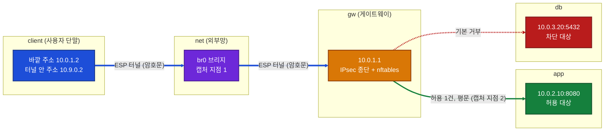
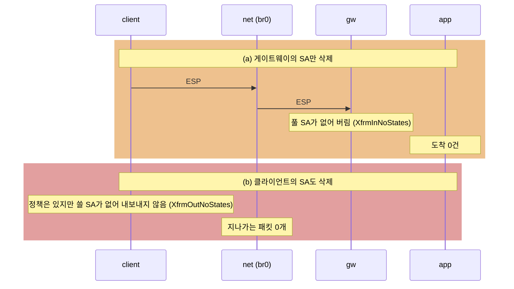

# ipsec-gateway-lab

리눅스 네트워크 네임스페이스만으로 만든 작은 VPN 게이트웨이 실습입니다.
클라이언트와 게이트웨이 사이를 IPsec(ESP 터널 모드)으로 암호화하고, 게이트웨이에서 기본 거부 + 명시 허용으로 접근을 제어한 뒤, 패킷 캡처와 연결 매트릭스로 확인합니다.

제품이 아니라 학습용 실습입니다. 리눅스 커널 기능(`ip netns`, `ip xfrm`, `nftables`)을 셸 스크립트로 조립했습니다.

## 확인하려는 것

1. 터널을 지나는 요청은 외부망에서 ESP로만 보이고, 터널 안 주소·포트·내용은 보이지 않는가
2. 암호화와 접근제어는 별개인가 — 터널로 들어왔더라도 허용 목록에 없는 목적지는 막히는가
3. 터널을 거치지 않은 요청은 막히는가
4. 차단은 이유와 함께 기록되는가
5. SA가 사라졌을 때 요청이 평문으로 새지 않는가

## 구성



| 네임스페이스 | 역할 |
|---|---|
| `client` | 사용자 단말. 터널 안 주소 `10.9.0.2`로 내부망에 접근 |
| `net` | 클라이언트와 게이트웨이 사이의 외부망(브리지). 제3자가 보는 패킷을 여기서 캡처 |
| `gw` | 게이트웨이. IPsec 종단 + nftables 접근제어 |
| `app`, `db` | 내부 서버. 둘 다 실제로 포트를 열고 있음 |

- IPsec: ESP 터널 모드, AES-GCM, 방향별 SA 2개. 키는 실행할 때마다 새로 만들고 출력하지 않습니다 → [lab/setup.sh](lab/setup.sh)
- 접근제어: forward 체인 기본 거부, 허용 1건(`터널 사용자 → app:8080`), 차단은 이유별 카운터 → [lab/policy.nft](lab/policy.nft)

## 이론과 명령의 대응

정보보안기사를 준비하며 글로 배운 IPsec·접근통제 개념이 리눅스에서 어떤 명령과 패킷으로 나타나는지 맞춰 보려고 만들었습니다.

| 이론 | 이 실습에서 | 눈으로 확인하는 곳 |
|---|---|---|
| ESP: 기밀성과 무결성을 제공하는 IPsec 프로토콜 | `proto esp` | 외부망 캡처의 `ESP(spi=…)` |
| 터널 모드: 원래 IP 패킷 전체를 암호화하고 새 IP 헤더를 붙임 | `mode tunnel` | 외부망에는 바깥 주소 `10.0.1.2 > 10.0.1.1`만, 안쪽 주소 `10.9.0.2`는 안 보임 |
| SA(보안 연관): 단방향이고 SPI로 식별 | `ip xfrm state` 2개 (`spi 0x1001`, `0x1002`) | 방향마다 다른 SPI가 캡처에 찍힘 |
| 보안 정책(SPD): 어떤 트래픽에 IPsec을 적용할지 | `ip xfrm policy` | 터널 안 주소로 보낸 요청만 ESP로 나감 |
| 재전송 방지: 순서 번호와 윈도우 | `replay-window 32` | 캡처의 `seq=0x1, 0x2, …` |
| 인증 암호화(AEAD) | `aead rfc4106(gcm(aes))` | SA 출력 |
| ARP: IP 주소로 MAC 주소를 알아냄 | 설정 없음 (커널이 첫 패킷 전에 자동 수행) | 두 캡처 맨 앞의 `ARP, Request who-has …`. IPsec은 IP 계층부터 보호하므로 ARP는 터널 밖에서 평문으로 보임 |
| 키 교환(IKE) | 없음 — 키를 스크립트가 직접 넣음 | 「한계」 참조 |
| 기본 거부 + 명시 허용 | nftables `policy drop` + 허용 1줄 | 연결 매트릭스, 카운터 |

## 실행

GitHub Actions가 푸시마다 전체를 실행합니다. 실행 화면의 **Summary**에 연결 매트릭스, 카운터, 패킷 캡처가 표시되고, 원본은 `evidence` 아티팩트로 남습니다.

로컬(리눅스, root):

```bash
sudo ./run.sh
```

macOS에서는 Docker로 실행합니다.

```bash
docker run --rm --privileged -v "$PWD":/lab ubuntu:24.04 bash -c 'apt-get update -qq && apt-get install -y -qq iproute2 nftables tcpdump curl python3 && /lab/run.sh'
```

## 검사 항목

[run.sh](run.sh)는 아래가 하나라도 어긋나면 실패로 끝납니다.

| 검사 | 기대 |
|---|---|
| 외부망 캡처 | ESP 패킷이 있고, 터널 안 주소(`10.9.0.2`)와 포트(`8080`)는 0건 |
| 터널 안쪽 캡처 | 복호화된 HTTP 요청이 보임 |
| 터널 → app:8080 | ALLOW |
| 터널 → app:22 | DROP (허용 외 포트) |
| 터널 → db:5432 | DROP (허용 외 서버, 포트는 열려 있음) |
| 터널 없이 → app:8080 | DROP |
| 카운터 | `allow_app`, `deny_no_tunnel`, `deny_not_allowed` 모두 0보다 큼 |
| 장애 실험 (a)(b) | 요청 실패, 외부망 평문 0건, app 도착 0건 |

결과는 세 가지로 나눕니다. `ALLOW`는 응답을 받은 것, `DROP`은 시간 초과(패킷이 조용히 버려짐), `REFUSED`는 연결 거부(서버까지 갔는데 포트가 닫혀 있음)입니다. 정책이 막았다면 `DROP`이어야 하고, `REFUSED`가 나오면 정책이 아니라 닫힌 포트 때문에 실패한 것이므로 검사가 실패합니다.

허용해야 할 쌍만 보면 "전부 열려 있는" 상태도 통과하고, 막아야 할 쌍만 보면 "전부 막힌" 상태도 통과합니다. 그래서 둘 다 검사합니다.

## 장애 실험: SA가 사라지면 평문으로 새는가

VPN에서 가장 피해야 할 실패는 "터널이 깨졌는데 요청이 평문으로 그대로 나가는 것"입니다. 보안 정책(SP)은 그대로 두고 SA만 지워서 확인했습니다.



| 상황 | 요청 결과 | 외부망 ESP | 외부망 평문 | app 도착 | 커널 통계 |
|---|---|---|---|---|---|
| (a) 게이트웨이의 SA 삭제 | DROP | 2 | 0 | 0 | gw `XfrmInNoStates=2` |
| (b) 클라이언트의 SA도 삭제 | DROP | 0 | 0 | 0 | client `XfrmOutNoStates=6` |

(로컬 Docker와 GitHub Actions에서 같은 값. 패킷 수는 재전송 횟수에 따라 달라질 수 있고, 검사는 "요청 실패, 평문 0건, app 도착 0건"만 봅니다.)

- (a) 클라이언트는 계속 암호화해 보냈지만(ESP 2개) 게이트웨이가 풀 SA가 없어 버렸습니다. 암호문은 내부로 전달되지 않았습니다.
- (b) 클라이언트는 "이 목적지는 ESP로 보내라"는 정책은 있는데 쓸 SA가 없어서, 패킷을 아예 내보내지 않았습니다. 외부망에는 아무것도 지나가지 않았습니다.
- 두 경우 모두 실패하면 닫히는 쪽으로 동작했습니다. 대신 요청은 2초 시간 초과로 끝나고, 사용자에게는 이유가 보이지 않습니다. 원인은 커널 통계(`/proc/net/xfrm_stat`)에만 남습니다. 운영한다면 이 값을 감시 대상으로 삼아야 합니다.
- 순서는 (a) 다음 (b)입니다. (b)는 게이트웨이 SA도 없는 상태에서 실행했습니다.

## 만들면서 틀렸던 것

**닫힌 포트로는 정책을 검사할 수 없다.**
`터널 → app:22`가 차단되는지 검사했는데, app은 22번 포트를 열고 있지 않았습니다. 정책이 전혀 없어도 "실패"로 나오는 검사였습니다. 처음 검사는 성공과 실패만 구분해서 이 차이를 볼 수 없었습니다. 결과를 `DROP`(시간 초과)과 `REFUSED`(연결 거부)로 나누고, 정책이 막은 경우에만 통과하도록 바꿨습니다.

**수신 측 인터페이스에서 캡처하면 평문이 보인다.**
처음에는 게이트웨이의 외부 쪽 인터페이스(`gw-wan`)에서 캡처했습니다. ESP 패킷 바로 다음 줄에 `10.9.0.2 > 10.0.2.10.8080` 평문 SYN이 찍혀서, "평문 노출 0건" 검사가 실패했습니다.

암호화가 안 된 것이 아니었습니다. 리눅스는 ESP를 복호화한 뒤 안쪽 패킷을 같은 인터페이스로 다시 받은 것처럼 처리하기 때문에, 수신 측에서 캡처하면 암호문과 복호화된 패킷이 둘 다 보입니다. 선 위를 지나가는 것을 보려면 양 끝이 아닌 중간에서 캡처해야 합니다. 그래서 둘 사이에 `net` 네임스페이스(브리지)를 넣고 거기서 캡처하도록 바꿨습니다.

## 한계

- SA와 키를 스크립트가 직접 넣습니다. 키 교환(IKE), 키 교체, 사용자 인증이 없습니다. 사용자는 터널 안 주소 하나로만 식별됩니다.
- 한 호스트 안의 네임스페이스입니다. 실제 NAT, MTU·단편화, 패킷 손실은 다루지 않습니다.
- 게이트웨이는 한 대입니다. 이중화와 장애 전환은 없습니다.
- 차단 기록은 카운터까지입니다. 어떤 연결이 막혔는지 건별 로그는 남기지 않습니다.
- ARP는 암호화 대상이 아니어서 외부망에 그대로 보입니다. 외부망에서 ARP 스푸핑을 했을 때 어떻게 되는지는 실험하지 않았습니다.
- 지연은 측정하지 않았습니다.

## AI 도구 사용

스크립트와 문서 초안은 AI 도구(Claude Code)로 작성했습니다. 구성 범위와 검사 항목은 직접 정했고, 실행 결과는 직접 확인했습니다.
